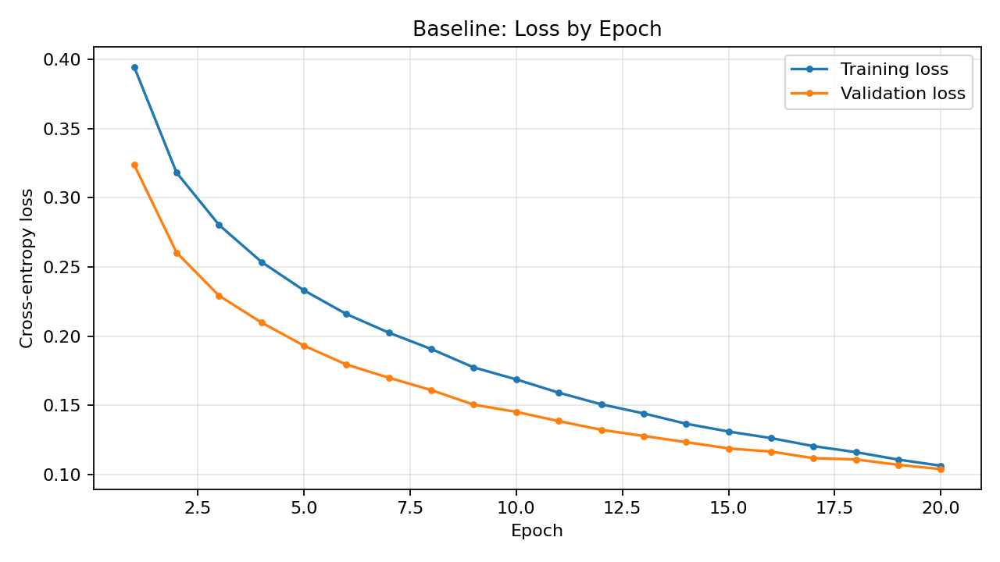
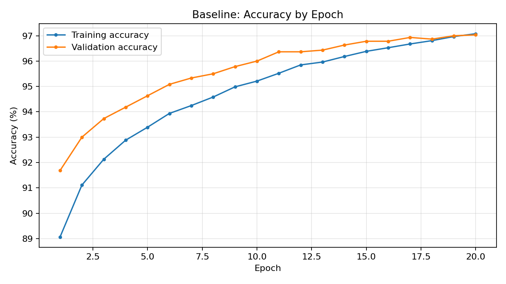
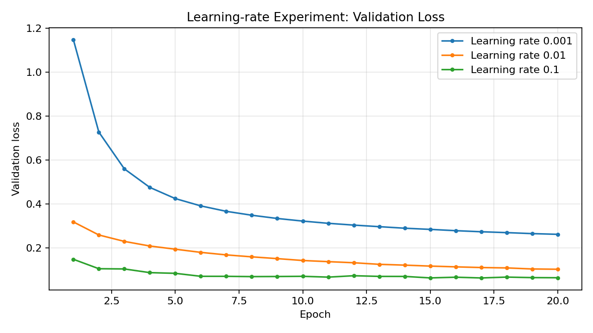
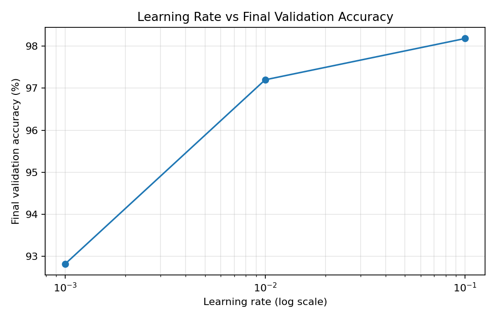
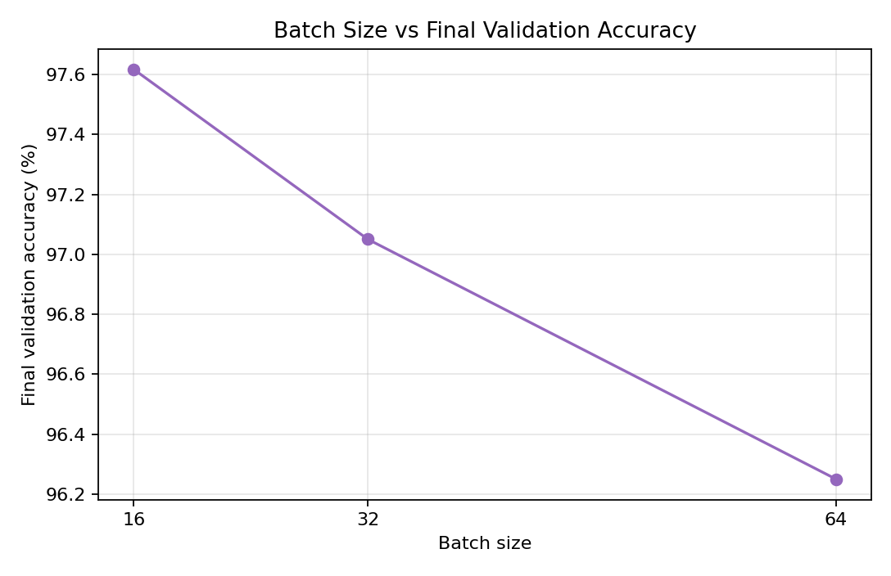
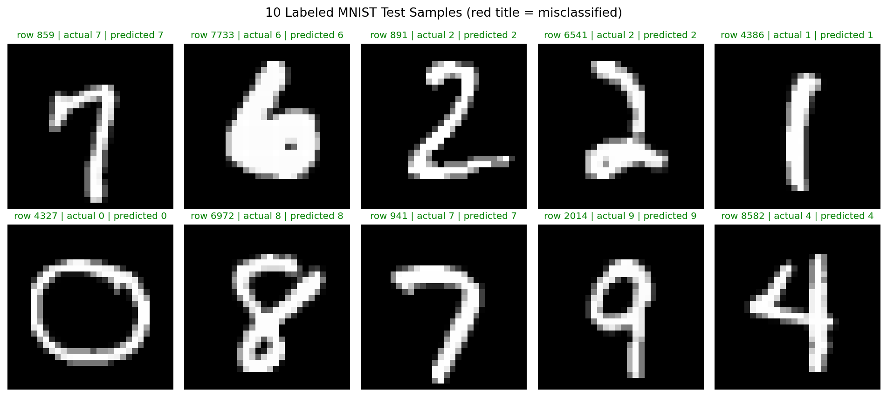

# Handwritten Digit Recognition with a From-Scratch ANN

This project uses a one-hidden-layer artificial neural network implemented with
NumPy to classify MNIST handwritten digits. The notebook includes baseline
training, learning-rate and batch-size experiments, and a check of 10 labeled
test images. It does not use a neural-network training library.

## Project files

- `ANN.ipynb` — notebook containing the ANN implementation and experiments.
- `Data/mnist_test.csv` — labeled MNIST test samples.
- `Data/mnist_train.csv` — required training data; excluded from this repository
  because it exceeds GitHub's 100 MiB file limit.

## Dataset setup

Place the MNIST training CSV at:

```text
Data/mnist_train.csv
```

The CSV must have a `label` column and 784 pixel columns. The notebook loads
`Data/mnist_test.csv` for its 10-image test section. Keep the training CSV out
of Git; `.gitignore` excludes it.

## Run the notebook

Install the notebook dependencies in your Python environment:

```bash
python -m pip install numpy pandas matplotlib jupyter
```

Open `ANN.ipynb` in Jupyter or VS Code and run the cells from top to bottom.
The experiments use fixed random seeds so their model initialization and
sample selection are reproducible.

---

## 1. Complete Model Code

```python
# 1. Imports
import numpy as np
import pandas as pd
import matplotlib.pyplot as plt
import time

# 2. Basic constants
INPUT_SIZE = 784
HIDDEN_LAYER_SIZE = 128
OUTPUT_SIZE = 10

LEARNING_RATE = 0.01
BATCH_SIZE = 32
EPOCHS = 20

np.random.seed(42)

# 3. Load the dataset
df = pd.read_csv("Data/mnist_train.csv")
print(df.shape)
print(df.head())

# 4. Prepare features and labels
Y = df["label"].to_numpy()
X = df.drop("label", axis=1).to_numpy()
X = X / 255.0

print("X shape:", X.shape)
print("Y shape:", Y.shape)
print("Minimum pixel value:", X.min())
print("Maximum pixel value:", X.max())

# 5. Train/validation split
x_train = X[:54000]
y_train = Y[:54000]
x_validation = X[54000:]
y_validation = Y[54000:]

print("Training data:", x_train.shape)
print("Training labels:", y_train.shape)
print("Validation data:", x_validation.shape)
print("Validation labels:", y_validation.shape)

# 6. Activation and loss functions
def relu(values):
    return np.maximum(0.0, values)


def softmax(values):
    shifted = values - np.max(values, axis=1, keepdims=True)
    exponentials = np.exp(shifted)
    return exponentials / np.sum(exponentials, axis=1, keepdims=True)


def forward_pass(x_batch, W1, B1, W2, B2):
    hidden_linear = x_batch @ W1 + B1
    hidden_activation = relu(hidden_linear)
    output_logits = hidden_activation @ W2 + B2
    probabilities = softmax(output_logits)
    return probabilities, hidden_linear, hidden_activation


def cross_entropy_loss(probabilities, labels):
    epsilon = 1e-15
    selected = probabilities[np.arange(len(labels)), labels]
    selected = np.clip(selected, epsilon, 1.0 - epsilon)
    return -np.mean(np.log(selected))


def accuracy(probabilities, labels):
    predictions = np.argmax(probabilities, axis=1)
    return np.mean(predictions == labels)

# 7. Training function with epoch-by-epoch tracking
def train_model(learning_rate, batch_size, hidden_neurons, epochs, seed=42):
    """Train a one-hidden-layer ANN and return full epoch-wise metrics."""
    rng = np.random.default_rng(seed)

    W1 = rng.standard_normal((INPUT_SIZE, hidden_neurons)) * np.sqrt(2.0 / INPUT_SIZE)
    B1 = np.zeros(hidden_neurons)
    W2 = rng.standard_normal((hidden_neurons, OUTPUT_SIZE)) * np.sqrt(2.0 / hidden_neurons)
    B2 = np.zeros(OUTPUT_SIZE)

    train_losses = []
    validation_losses = []
    train_accuracies = []
    validation_accuracies = []

    start_time = time.time()

    for epoch in range(epochs):
        shuffled_indices = rng.permutation(len(x_train))

        for start in range(0, len(x_train), batch_size):
            batch_indices = shuffled_indices[start:start + batch_size]
            x_batch = x_train[batch_indices]
            y_batch = y_train[batch_indices]

            probabilities, hidden_linear, hidden_activation = forward_pass(x_batch, W1, B1, W2, B2)

            grad_logits = probabilities.copy()
            grad_logits[np.arange(len(y_batch)), y_batch] -= 1.0
            grad_logits /= len(y_batch)

            dW2 = hidden_activation.T @ grad_logits
            dB2 = np.sum(grad_logits, axis=0)

            hidden_gradient = grad_logits @ W2.T
            hidden_gradient *= (hidden_linear > 0)

            dW1 = x_batch.T @ hidden_gradient
            dB1 = np.sum(hidden_gradient, axis=0)

            W1 -= learning_rate * dW1
            B1 -= learning_rate * dB1
            W2 -= learning_rate * dW2
            B2 -= learning_rate * dB2

        train_probabilities, _, _ = forward_pass(x_train, W1, B1, W2, B2)
        validation_probabilities, _, _ = forward_pass(x_validation, W1, B1, W2, B2)

        train_losses.append(cross_entropy_loss(train_probabilities, y_train))
        validation_losses.append(cross_entropy_loss(validation_probabilities, y_validation))
        train_accuracies.append(accuracy(train_probabilities, y_train) * 100.0)
        validation_accuracies.append(accuracy(validation_probabilities, y_validation) * 100.0)

    elapsed_seconds = time.time() - start_time

    return {
        "train_losses": train_losses,
        "validation_losses": validation_losses,
        "train_accuracies": train_accuracies,
        "validation_accuracies": validation_accuracies,
        "final_train_loss": train_losses[-1],
        "final_validation_loss": validation_losses[-1],
        "final_train_accuracy": train_accuracies[-1],
        "final_validation_accuracy": validation_accuracies[-1],
        "training_time_seconds": elapsed_seconds,
        "W1": W1,
        "B1": B1,
        "W2": W2,
        "B2": B2,
    }
```

---

## 2. Experiments

### 2.1 Baseline experiment

Parameters: learning rate = 0.01, batch size = 32, hidden neurons = 128, epochs = 20

Measured result:

- Final training loss: 0.1064
- Final validation loss: 0.10396
- Final training accuracy: 97.08%
- Final validation accuracy: 97.03%





### 2.2 Learning-rate experiment

Tested learning rates: 0.001, 0.01, 0.1

| Learning rate | Final validation loss | Final validation accuracy |
| --- | ---: | ---: |
| 0.001 | 0.2619 | 92.82% |
| 0.01 | 0.1027 | 97.20% |
| 0.1 | 0.0641 | 98.18% |

Best learning rate: 0.1





### 2.3 Batch-size experiment

Tested batch sizes: 16, 32, 64

| Batch size | Final validation loss | Final validation accuracy |
| --- | ---: | ---: |
| 16 | 0.0816 | 97.62% |
| 32 | 0.1074 | 97.05% |
| 64 | 0.1475 | 96.25% |

Best batch size: 16



### Experiment summary

- Baseline converged steadily with both training and validation loss decreasing.
- Learning rate 0.1 produced the best final validation accuracy (98.18%).
- Batch size 16 gave the best validation result among the tested batch sizes (97.62%).

---

## 3. Test on 10 Labeled Samples from `mnist_test.csv`

The model was evaluated on 10 randomly selected labeled test images using the best-performing learning-rate configuration (0.1).

### 3.1 Evaluation output

```text
TEST RESULTS
1,859,7,7,correct
2,7733,6,6,correct
3,891,2,2,correct
4,6541,2,2,correct
5,4386,1,1,correct
6,4327,0,0,correct
7,6972,8,8,correct
8,941,7,7,correct
9,2014,9,9,correct
10,8582,4,4,correct
```

### 3.2 Result summary

- All 10 selected test images were classified correctly.
- No misclassifications were found in the chosen sample set.

### 3.3 Visual inspection of the 10 test images



The selected images are labeled as follows:

- Sample 1: actual 7, predicted 7
- Sample 2: actual 6, predicted 6
- Sample 3: actual 2, predicted 2
- Sample 4: actual 2, predicted 2
- Sample 5: actual 1, predicted 1
- Sample 6: actual 0, predicted 0
- Sample 7: actual 8, predicted 8
- Sample 8: actual 7, predicted 7
- Sample 9: actual 9, predicted 9
- Sample 10: actual 4, predicted 4

### 3.4 Notes

- The experiment uses a fixed random seed for reproducibility.
- The training CSV is intentionally excluded from GitHub because it exceeds the 100 MB file limit.
- The notebook is designed to run once the training CSV is placed in `Data/mnist_train.csv`.
